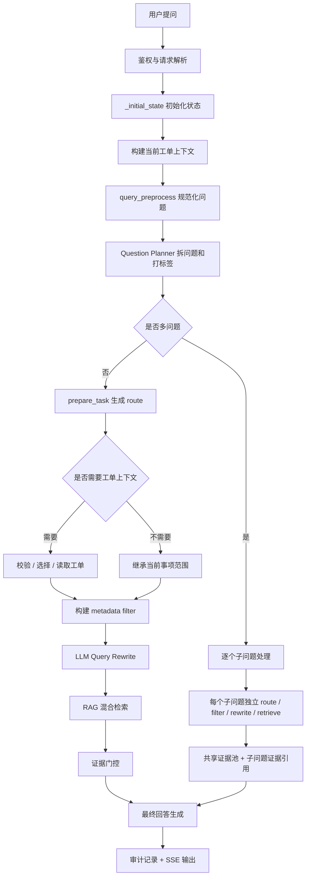

# 政务申报辅助问答系统

本项目是一个面向政务申报场景的智能问答系统，支持申请材料、办理流程、办理条件、办理时限、进度查询、驳回原因解释、补正建议、证据来源展示、会话审计和 SSE 流式输出。

技术栈：

- 后端：FastAPI、LangGraph、SQLAlchemy
- 存储：PostgreSQL、Redis、Milvus
- 检索：向量检索、BM25、RRF、Rerank、metadata filter
- 模型：Question Planner、LLM Query Rewrite、LLM Answer Generator
- 前端：React / 静态页面，支持会话、工单选择、证据来源、Workflow 事件、反馈和评估

当前版本的重点设计是：**Question Planner 负责拆问题和打控制流标签，Query Rewrite 负责检索语义改写，RAG 负责严格按事项范围召回证据，最终回答必须基于可追溯证据生成。**

## 目录结构

```text
.
├── declaration_qa/
│   ├── server.py             # FastAPI 路由、SSE 输出
│   ├── workflow.py           # LangGraph 问答主流程
│   ├── question_planner.py   # 多问题拆解、控制流打标
│   ├── query_rewriter.py     # LLM Query Rewrite + 规则兜底
│   ├── rag_engine.py         # 混合检索、RRF、Rerank、证据扩展
│   ├── retrieval.py          # metadata filter 标准化
│   ├── vector_index.py       # Memory / Milvus 向量索引
│   ├── prompting.py          # 最终回答 Prompt
│   ├── repository.py         # PostgreSQL 存储层
│   ├── model_providers.py    # LLM / Embedding / Rerank 构建
│   └── schemas.py            # API 请求响应模型
├── frontend/                 # 前端页面
├── sql/postgresql/           # PostgreSQL schema 和种子数据
├── materials/                # 知识材料
├── tests/                    # 测试
├── docker-compose.yml
└── README.md
```

## 快速启动

创建环境：

```powershell
python -m venv .venv
.\.venv\Scripts\activate
pip install -r requirements-dev.txt
```

准备配置：

```powershell
copy .env.example .env
```

启动基础设施：

```powershell
docker compose up -d
```

启动 API：

```powershell
python -m uvicorn declaration_qa.server:app --host 127.0.0.1 --port 8000 --reload
```

启动前端：

```powershell
cd frontend
python -m http.server 5173
```

打开：

```text
http://127.0.0.1:5173
```

如果使用异步入库，需要启动 worker：

```powershell
python -m declaration_qa.worker
```

## 核心配置

常用环境变量：

| 配置 | 说明 |
| --- | --- |
| `DECLARATION_QA_DATABASE_URL` | PostgreSQL 连接地址 |
| `DECLARATION_QA_REDIS_URL` | Redis 连接地址 |
| `DECLARATION_QA_VECTOR_BACKEND` | `memory` 或 `milvus` |
| `DECLARATION_QA_MILVUS_URI` | Milvus 地址 |
| `DECLARATION_QA_MILVUS_COLLECTION` | Milvus collection |
| `DECLARATION_QA_KEYWORD_BACKEND` | `memory` 或 `elasticsearch` |
| `DECLARATION_QA_ELASTICSEARCH_URL` | Elasticsearch 地址 |
| `DECLARATION_QA_ELASTICSEARCH_INDEX` | Elasticsearch chunk 索引 |
| `DECLARATION_QA_LLM_PROVIDER` | LLM provider |
| `DECLARATION_QA_LLM_MODEL` | 回答生成模型 |
| `DECLARATION_QA_QUESTION_PLANNER_MODEL` | Planner 模型，不填时走默认 LLM 配置或规则兜底 |
| `DECLARATION_QA_QUERY_REWRITER_MODEL` | Query Rewrite 模型 |
| `DECLARATION_QA_MAX_SUB_QUESTION_WORKERS` | 多子问题并发数 |
| `DECLARATION_QA_MAX_RETRIEVAL_WORKERS` | 多路检索并发兜底数 |
| `DECLARATION_QA_EMBEDDING_PROVIDER` | Embedding provider |
| `DECLARATION_QA_RERANK_PROVIDER` | Rerank provider |

未配置真实服务时，系统可以使用内存存储、Hash Embedding、规则 Planner、规则 Query Rewrite 和确定性回答生成器，方便本地开发。

## 当前问答流程

整体链路：



关键点：

1. `Question Planner` 只负责拆分问题和打标签，不做语义补全。
2. `prepare_task` 根据 Planner 输出生成 route，当前不再额外运行独立 Router 层。
3. 已选工单会成为本轮对话的默认事项范围。
4. Query Rewrite 只改写检索 query，不生成 metadata filter。
5. RAG 检索必须遵守 metadata filter，避免跨事项召回。
6. 最终回答必须基于检索证据和工单事实，不允许模型自行猜测业务状态。

性能上，当前实现有两层并发：

- 多问题场景下，多个子问题会在 `multi_question_collect` 中并发处理。
- 单个子问题内部，多路 rewrite query 会优先走 `retrieve_many()`，合并为批量 Embedding 和批量向量检索；如果 batch 失败，再退回线程池并发检索。

## Question Planner

Planner 的职责很轻：

- 判断用户一句话里是否包含多个子问题。
- 按原始表达顺序拆成 `questions`。
- 给每个子问题打控制流标签。

核心输出字段：

| 字段 | 说明 |
| --- | --- |
| `is_multi_question` | 是否多问题 |
| `query` | 子问题原始表达，保留口语和指代词 |
| `requires_ticket_context` | 是否依赖具体工单 |
| `ticket_fact_type` | 需要读取的工单事实，如 `status`、`rejection`、`correction`、`none` |
| `retrieval_focus` | 检索关注点，如材料、流程、时限、费用、地点、咨询方式等 |

Planner 不负责把“这个事情最快几天”扩写成完整事项名。事项范围由工单上下文和 metadata filter 保证，语义补全交给 Query Rewrite。

## 工单上下文

系统中有两类问题：

- 工单相关问题：例如“我这单为什么被退回”“现在到哪一步了”“还要补什么”。
- 通用指南问题：例如“需要哪些材料”“多久能办完”“咨询电话是多少”。

如果用户已经选择了某笔工单，那么即使后续问题是通用指南问题，也默认继承这笔工单对应的事项范围。

例如：

```text
我上周把草原施工材料交了，今天看被退回来了，顺便问下这个事情最快几天能拿结果？
```

应拆成两个子问题：

1. “今天看被退回来了”：需要工单上下文，读取退回原因。
2. “这个事情最快几天能拿结果”：是通用时限问题，但继承当前工单的事项范围。

这样可以避免第二个问题因为没有显式事项名而检索到其他事项。

## metadata filter

知识库检索不使用 `biz_type` 过滤。

原因：

- `biz_type` 是业务系统侧的类型字段。
- 知识文档和 Milvus 字段中没有稳定的 `biz_type`。
- 知识检索应该优先按事项编码和事项名称约束。

当前优先使用的过滤字段：

| 字段 | 说明 |
| --- | --- |
| `item_code` | 事项编码，优先级最高 |
| `ssqd_code` | 实施清单编码 |
| `ssqd_id` | 实施清单 ID |
| `item_name` | 事项名称 |
| `region_code` | 区域 |
| `app_version` | 应用版本 |
| `policy_version` | 政策版本 |

当用户已绑定工单时，workflow 会从工单上下文里提取事项信息，生成 metadata filter，并传给 RAG 和 Milvus。

## Query Rewrite

Query Rewrite 当前是 LLM 优先、规则兜底。

输入包含：

- 用户原始问题
- Planner 标签
- 当前事项范围
- 必要的工单事实摘要
- metadata filter 是否已经包含事项范围

输出包含多路检索 query：

```json
{
  "provider": "llm",
  "queries": [
    "办理时限 承诺办结 法定办结",
    "该事项 最快 几天 拿到结果",
    "审批结果 办结时限"
  ],
  "reason": "rewrite for time-limit retrieval"
}
```

注意：

- Query Rewrite 不负责选择事项。
- Query Rewrite 不负责生成 filter。
- 如果 metadata filter 已经限定事项，改写时会避免重复塞事项名，减少 query 污染。

## RAG 检索

RAG 检索流程：

1. 标准化 metadata filter。
2. 本地模式从内存 chunk 池检索；生产外部模式将 metadata filter 下推给 Milvus 和 Elasticsearch。
3. Milvus 返回向量候选 `chunk_id + score`，Elasticsearch 返回 BM25 候选 `chunk_id + score`。
4. PostgreSQL 按 `chunk_id` 批量回表加载 chunk 内容和 metadata。
5. 使用 RRF 融合多路召回结果。
6. 使用 Rerank 重排。
7. 命中 child 后按需从 PostgreSQL 加载 parent 或同一结构化章节 sibling。
8. 返回证据来源和检索诊断信息。

多问题场景下，每个子问题独立检索，最终会构造共享证据池：

```text
<SharedEvidencePool>
  <Evidence id="doc_a1">...</Evidence>
  <Evidence id="doc_b2">...</Evidence>
</SharedEvidencePool>

<SubQuery_1>
  <Question>...</Question>
  <EvidenceRefs>
    <Ref>doc_a1</Ref>
  </EvidenceRefs>
</SubQuery_1>
```

最终回答模型只能使用子问题授权的证据引用，避免不同问题之间串用材料。

## 回答生成

回答生成分两条链路：

| 链路 | 场景 |
| --- | --- |
| `knowledge_retrieval` | 通用知识问答，如材料、流程、时限、电话 |
| `ticket_augmented` | 工单增强问答，如进度、退回、补正、当前状态 |

如果证据不足，系统会拒答或提示用户选择工单，而不是让模型编造。

回答生成后会写入：

- session message
- audit log
- workflow events
- sources
- feedback entry

## SSE 事件

流式接口：

```text
POST /api/declaration-qa/chat/stream
```

常见事件：

| 事件 | 说明 |
| --- | --- |
| `run_started` | 开始处理 |
| `context_built` | 已构建工单上下文 |
| `query_preprocessed` | 问题规范化完成 |
| `question_plan` | Planner 输出 |
| `ticket_selected` | 工单已选择 |
| `knowledge_filter` | 已生成 metadata filter |
| `query_rewrite` | Query Rewrite 输出 |
| `sources` | 证据来源 |
| `answer_delta` | 流式回答片段 |
| `audit_logged` | 审计完成 |
| `done` | 完成 |

前端右侧 Workflow 事件面板就是基于这些事件展示。

## 主要接口

| 接口 | 说明 |
| --- | --- |
| `GET /api/declaration-qa/health` | 健康检查 |
| `POST /api/declaration-qa/chat` | 普通问答 |
| `POST /api/declaration-qa/chat/stream` | SSE 流式问答 |
| `GET /api/declaration-qa/tickets` | 查询候选工单 |
| `GET /api/declaration-qa/sessions` | 会话列表 |
| `GET /api/declaration-qa/sessions/{session_id}` | 会话详情 |
| `DELETE /api/declaration-qa/sessions/{session_id}` | 删除会话历史 |
| `GET /api/declaration-qa/audit/{audit_id}` | 审计详情 |
| `POST /api/declaration-qa/feedback` | 反馈 |
| `POST /api/declaration-qa/knowledge/upload` | 单文件入库 |
| `POST /api/declaration-qa/knowledge/uploads` | 批量入库 |
| `GET /api/declaration-qa/knowledge/documents` | 文档列表 |
| `POST /api/declaration-qa/knowledge/reindex` | 重建索引 |
| `POST /api/declaration-qa/evaluation/datasets` | 创建评测集 |
| `POST /api/declaration-qa/evaluation/datasets/{dataset_id}/runs` | 运行评测 |

## 调试重点

排查问答问题时优先看这些字段：

| 位置 | 重点 |
| --- | --- |
| `/health` | 当前使用的是内存还是 PostgreSQL / Milvus / LLM |
| Workflow 事件 | Planner、工单选择、filter、rewrite、sources 是否符合预期 |
| audit 详情 | 完整 question_plan、retrieval_filter、retrieval_queries、final_prompt |
| sources | 是否召回到正确事项、正确材料 |
| rag_status | 是否启用 metadata_filtering、召回数量是否正常 |

常见问题：

| 现象 | 优先检查 |
| --- | --- |
| 绑定工单后仍检索到别的事项 | `knowledge_filter` 是否包含 `item_code` 或 `item_name` |
| 一个问题被错误拆成多个 | `question_plan.questions` 和 `reason` |
| Query Rewrite 把事项名重复塞进 query | `metadata_filter_has_item_scope` 是否为 true |
| 回答后才要求选工单 | 是否在检索前完成了 ticket selection |
| 材料清单缺失 | 文档是否已发布、chunk 是否带正确事项元数据 |
| Milvus 过滤无效 | 检查 Milvus collection 是否包含对应 metadata 字段 |

## 测试

运行全部测试：

```powershell
python -m pytest
```

常用测试：

```powershell
python -m pytest tests/declaration_qa_workflow_test.py -q
python -m pytest tests/declaration_qa_vector_index_test.py -q
python -m pytest tests/declaration_qa_production_test.py -q
```

如果 `.env` 配了真实 PostgreSQL，部分测试会按真实配置创建 store。排查测试差异时先看 `/health` 里的 `audit_store`、`vector_backend` 和 `production_ready`。

## 当前边界

- Planner 只拆问题和打标签，不做语义补全。
- Query Rewrite 只生成检索 query，不生成 metadata filter。
- `biz_type` 不参与知识库过滤。
- 工单状态、退回原因、补正信息必须来自业务数据。
- 多问题最终回答可以由一个模型汇总，但证据必须按子问题隔离。
- 生产环境需要真实 PostgreSQL、Redis、Milvus、Elasticsearch、Embedding、Rerank、LLM 和 worker。
