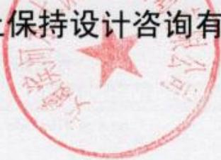

## 水土保持方案报告书

<table><tr><td rowspan=1 colspan=1>批准</td><td rowspan=1 colspan=3></td><td rowspan=7 colspan=1></td></tr><tr><td rowspan=1 colspan=1>核定</td><td rowspan=5 colspan=3></td></tr><tr><td rowspan=1 colspan=1>项目负责人</td><td rowspan=1 colspan=1></td></tr><tr><td rowspan=1 colspan=1>审查</td><td rowspan=1 colspan=1></td><td rowspan=1 colspan=1></td></tr><tr><td rowspan=2 colspan=1>编写</td><td rowspan=1 colspan=1></td><td rowspan=1 colspan=1></td></tr><tr><td rowspan=1 colspan=1></td></tr><tr><td rowspan=1 colspan=1>制图</td><td rowspan=1 colspan=3></td></tr></table>

“未加盖安徽滨河水土保持设计咨询有限公司公章对外无效”

seal

询公司
2

## 目录

1 综合说明1  
1.1 项目及项目区概况1  
1.2 主体工程水土保持分析评价结论…2  
1.3 防治责任范围及分区 3  
1.4 水土流失预测结果.... 3  
1.5 水土保持措施总体布局与主要工程量… 3  
1.6 水土保持监测 4  
1.7 水土保持投资估算及效益分析……4  
1.8 结论4  
2 编制总则9  
2.1 目的和意义  
2.2 编制依据  
2.3 水土流失防治执行标准13  
2.4 编制原则.... 13  
2.5 指导思想 14  
2.6 编制阶段、方案设计水平年及方案服务期…… 14  
3 项目概况15  
3.1 项目名称及工程性质15  
3.2 地理位置15  
3.3 建设规模 15  
3.4 项目组成及总体布置.. 17  
3.5 专项设施改（迁）建情况和工程建设穿跨越情况…………30  
3.8 工程占地及拆迁情况……30  
3.9 施工组织设计31  
3.10 投资及进度安排.. 34  
4 项目概况37  
4.1 自然概况... 37  
4.2 社会经济概况 42  
4.3 土地利用现状43  
4.4 水土流失及水土保持现状……43  
5 主体工程水土保持分析与评价……47  
5.1 主体工程选址水土保持制约因素分析与评价…47  
5.2 主体工程方案比选分析与评价…51  
5.3 推荐方案的水土保持分析评价51  
5.4 主体工程设计的水土保持功能分析与评价 … 60  
5.5 工程建设与运行对水土流失的影响分析63  
5.6 结论性意见、要求与建议…64  
6 防治责任范围及防治分区……65  
6.1 防治责任范围65  
6.2 防治分区66  
7 水土流失预测67  
7.1 扰动地表、损坏水土保持设施面积预测… 67  
7.2 弃渣量预测68  
7.3 可能造成的水土流失量的调查与预测……68  
7.4 水土流失危害分析73  
7.5 综合分析及指导性意见 7  
8 水土流失防治目标及防治措施布设………77  
8.1 防治目标及标准 77  
8.2 布设原则. 78  
8.3 防治措施总体布局和体系……78  
8.4 分区防治措施及典型设计81  
8.5 水土保持措施工程量92  
8.6 水土保持施工组织设计 94  
8.7 水土保持措施实施进度安排… 97  
9 水土保持监测99  
9.1 监测内容和重点.  
9.2 监测时段和频次...  
9.3 监测方法 100  
9.4 监测区域、监测点的布设…100  
9.5 监测设备、机构与人员……102  
9.6 监测制度 103  
9.7 水土保持监测成果要求  
10 投资估算及效益分析……105  
10.1 编制说明. 105  
10.2 投资估算表... 108  
10.3 效益分析. 116  
11 方案实施保障措施……119  
11.1 组织机构与管理119  
11.2 后续设计. 119  
11.3 工程施工. 120  
11.4 水土保持工程建设监理120  
11.5 水土保持监测. 120  
11.6 检查与验收....  
11.7 资金来源及使用管理……121  
12 结论与建议123