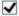

# 询问笔录

1、        你所提交的材料是否真实有效？

是                     口否

2、        你所申请的登记事项是否是你的真实意思表达？

是                  □ 否

3、        你所申请的登记房屋及非房屋类物权是否共有？

□ 是                    否

4、        其他

情况属实，同意抵押。

<table><tr><td></td></tr><tr><td></td></tr></table>

抵押人（签字）：                                               询问人：

2025年2月11日