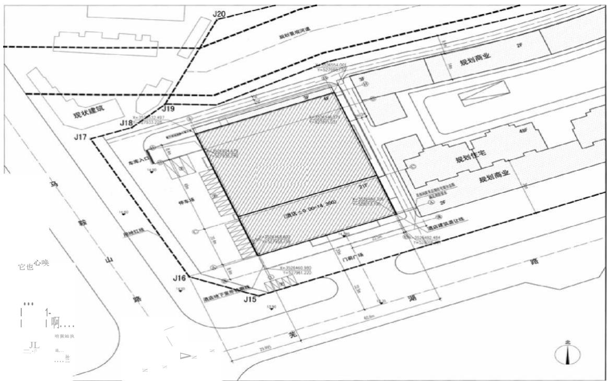
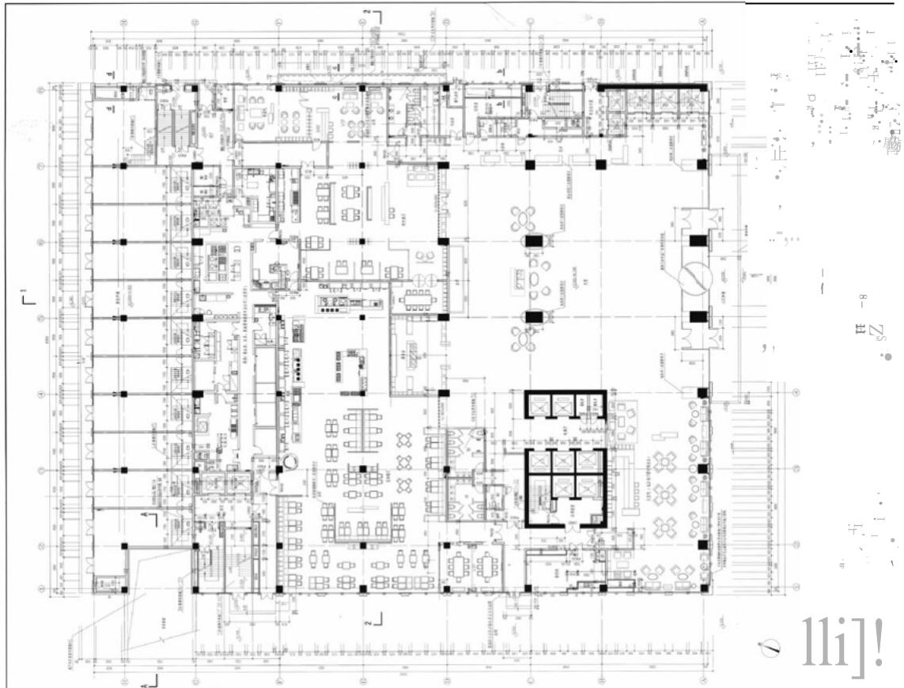
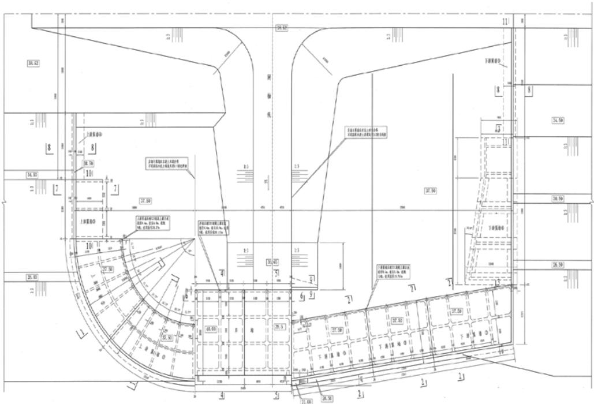
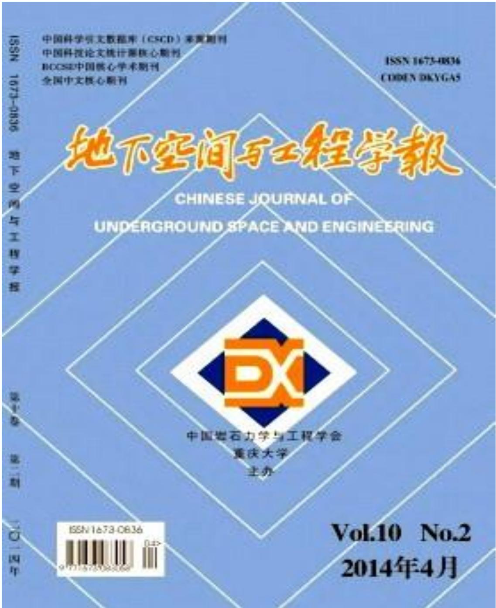

# 安徽省工程勘察设计大师申报

## 附件材料

## 目 录

一、 公示推荐（公示证明、推荐信、推荐意见）

二、 证件证书（身份证、学历证书、资格证书等）

三、 工程业绩（含主要勘察设计文件）

四、 项目获奖（证书、图签）

五、 学术成就（学术著作、论文、标准等）

六、 其他（发明专利、专有技术）

## 一、公示推荐

## 单位公示证明

安徽省工程勘察设计大师评选委员会办公室：

根据申报要求，我单位对XXX同志申报第X批安徽省工程勘察设计大师材料进行了审查，并于XXXX年XX月XX日至XX月XX日在本单位进行了公示。

申报材料经公示后无异议。

特此证明

单位名称：（公章）

年 月 日

安徽省工程勘察设计大师推荐信
<table><tr><td rowspan=3 colspan=1>申请人</td><td rowspan=1 colspan=1>姓名</td><td rowspan=1 colspan=3>张三</td></tr><tr><td rowspan=1 colspan=1>工作单位</td><td rowspan=1 colspan=3>XXXXX 设计院</td></tr><tr><td rowspan=1 colspan=1>申请行业</td><td rowspan=1 colspan=1>建筑</td><td rowspan=1 colspan=1>从事专业</td><td rowspan=1 colspan=1>建筑</td></tr><tr><td rowspan=4 colspan=1>推荐人</td><td rowspan=1 colspan=1>姓名</td><td rowspan=1 colspan=3>王五</td></tr><tr><td rowspan=1 colspan=1>工作单位</td><td rowspan=1 colspan=3>建筑学</td></tr><tr><td rowspan=1 colspan=1>从事专业</td><td rowspan=1 colspan=3>建筑</td></tr><tr><td rowspan=1 colspan=1>大师、院士名称及评选时间</td><td rowspan=1 colspan=3>安徽省工程勘察设计大师 XXXX 年 XX 月</td></tr></table>

## 推 荐 意 见

安徽省工程勘察设计大师评选委员会办公室：

根据省住房城乡建设厅、省人力资源社会保障厅《关于开展第X批安徽省工程勘察设计大师评选工作的通知》要求，依据《安徽省工程勘察设计大师评选与管理办法》，我单位对申报材料进行了审核，推荐XXXX、XXXX单位的XXX、XXX几位同志参加第X批安徽省工程勘察设计大师评选。

推荐排序：XXX、XXX……。

省级主管部门/XXX 协会：（公章）

XX年XX月XX日

## 三、工程业绩

## XXXXX 酒店项目简介

XXXXX 酒店设计前期规划强调用地集约，建筑布局、体量、空间处理上，力求融于环境，提升环境。结构设计大胆采取转换桁架、预应力大跨 度梁方式。设计中使用各项节能技术，在满足酒店舒适度的同时，力求节 能高效，极大降低了酒店后期运营及维护成本，取得了良好的环境和经济 效益。该酒店成为该区域最受欢迎的高端国际品牌酒店，是 XX 市的标志性建筑和形象工程，为提升合肥的影响力和城市形象都起到了积极的作用。

  
．．冥外幛高呵幔霞屑爆情况．碱谴崛谓董  
酒店总平面定位图 1 : 500

水连上速盘径松：水要接量9、反空差不小于氧.94、水泥±7天天到展抗压强度不小于1.3Pa，曲摩意角庄不心于0、妄聚力不小4.0婚2.4. 各创面图L库集地地构布置图(1/3.1/3).

## XXXX 建工程简介

工程位于 XX 市郊淮河干流上，是国家十九项治淮骨干工程之一。枢纽具有灌溉、航运、城市供水等多种功能。灌溉面积 100 万亩。枢纽设计泄洪流量 10000 立方米/秒，扩建工程流量 1000 立方米/秒。工程规模为Ⅰ等大(1)型，总投资 100 亿元。XXX 年XX 月通过竣工验收。工程已运行10 年，经历了两次淮河特大洪水考验，发挥了巨大的防洪减灾效益。技术上达到国际先进水平。

  
1. 图中高程瓜计，尺气以m2. 差中所示为左侧岸、紧通慰构布置，右侧与之对称布置，长右岸上海紧墙③与下游翼墙③长度与左岸不用，其右并长度：上通紧墙@32n，下通翼墟@043. 接后道+指标盖性+追盘压实度不小于生.54 粘性土填氧压实度不小于载.54

五、学术成就

(一)学术著作

历史建筑保护工程学

(二)论 文

(三)工程建筑标准

安徽省地方标准

J11887-2017

DB34/5076-2017

# 公共建筑节能设计标准

# Design standard for energy efficiency of public buildings

2017-12-25 发布

2018-07-01 实施

安徽省住房和城乡建设厅

安徽省质量技术监督局 联合发布