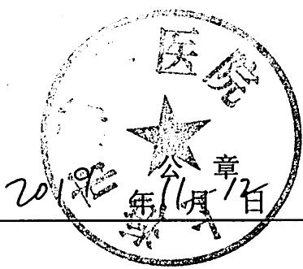

## 工作经历证明

<table><tr><td rowspan=1 colspan=1>姓名</td><td rowspan=1 colspan=1>77</td><td rowspan=1 colspan=2>性别</td><td rowspan=1 colspan=1>女</td><td rowspan=1 colspan=1>出生年月</td><td rowspan=1 colspan=1>1976.01</td></tr><tr><td rowspan=1 colspan=2>执业机构名称</td><td rowspan=1 colspan=5>上海市  医院</td></tr><tr><td rowspan=1 colspan=7>从事职业病防治、诊疗等相关工作经历</td></tr><tr><td rowspan=1 colspan=3>起止时间</td><td rowspan=1 colspan=2>单位</td><td rowspan=1 colspan=1>技术职务</td><td rowspan=1 colspan=1>从事何专业技术工作</td></tr><tr><td rowspan=1 colspan=3>2000年12月-2006年4月2006年4月-2016年4月2016年5月-2019年5月2019年5月-今</td><td rowspan=1 colspan=2>山东省医院山东省医院山东省医院上海市院</td><td rowspan=1 colspan=1>住院医师主治医师副主任医师主治医师</td><td rowspan=1 colspan=1>职业病科职业病科试职业病科销体检中心</td></tr><tr><td rowspan=1 colspan=3>本人专业技术工作述评(专业技术特长、成就、公开发表论文、专著等)          </td><td rowspan=1 colspan=4>自2000.12至今一直从事职业病临床及健康监护工作。首位主持完成山东省自然基金课题一项，首位主持完成山东省医科院课题一项。参与完成课题及国家卫生标准5项。公开发表论文10余篇。作为副主编发表专著2部。</td></tr><tr><td rowspan=1 colspan=7>本人承诺，以上情况属实。本人签字：2019年11月7日</td></tr><tr><td rowspan=1 colspan=3>执业机构(单位)意见</td><td rowspan=1 colspan=4>医院年       </td></tr></table>

seal

医
福
1
9
D
12
—

